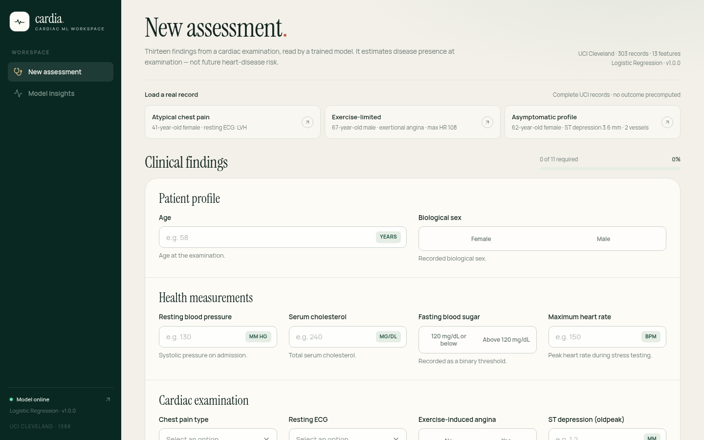
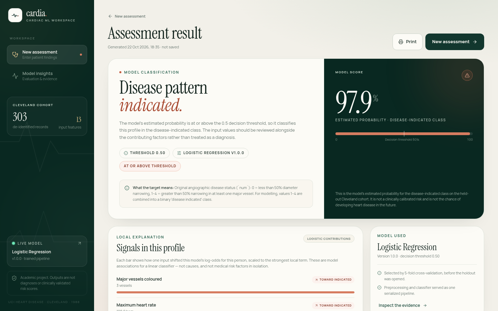
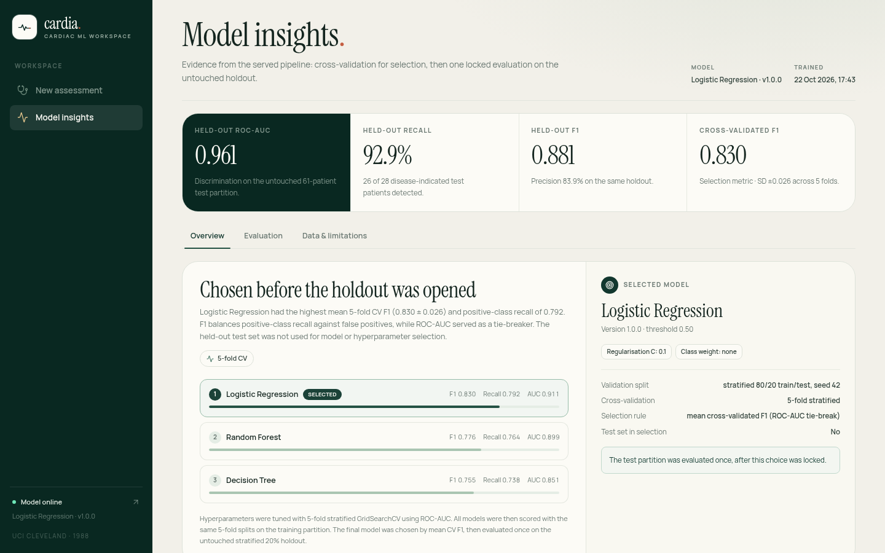

# Cardia — Heart Disease Detection with Machine Learning

Academic mini-project: **Heart Disease Risk Detection Using Machine Learning**.

**Live demo:** <https://cardia-heart-disease-alpha.vercel.app>

An end-to-end academic machine-learning application that classifies **presence of
angiographic coronary artery disease** from 13 structured findings in the official
UCI Cleveland heart-disease dataset. It combines a reproducible Python training
pipeline, a held-out evaluation, and a single **Next.js** application that serves
the model, API, and interface from one deployable codebase.

> **Research and teaching use only.** This is not a medical device, not a clinical
> risk score, and not a diagnosis. The target is disease presence at the time of
> examination, not the probability of developing heart disease in the future.



| Live result | Evaluation dashboard |
| --- | --- |
|  |  |

## Contents

- [What the application does](#what-the-application-does)
- [Results](#results)
- [Method](#method)
- [Dataset](#dataset)
- [Architecture](#architecture)
- [Project structure](#project-structure)
- [Setup](#setup)
- [Run the application](#run-the-application)
- [Deploy to Vercel](#deploy-to-vercel)
- [Retrain and reproduce](#retrain-and-reproduce)
- [API](#api)
- [Tests](#tests)
- [Design and privacy decisions](#design-and-privacy-decisions)
- [Limitations](#limitations)
- [Citation and license](#citation-and-license)

## What the application does

- Accepts the 13 original UCI Cleveland predictors through a grouped clinical form
  with validation, complete-record presets, and an explicit missing-value path for
  `ca` and `thal`.
- Runs the fitted model **inside Next.js route handlers**. The runtime applies the
  exact fitted imputers, scaler, one-hot categories, and logistic-regression
  coefficients exported from the scikit-learn pipeline. There is no FastAPI or
  Python process in production.
- Shows the thresholded model output, the estimated probability for the
  disease-indicated class, the decision threshold, an input summary, and the top
  local additive contributions for the linear model.
- Publishes model selection, cross-validation, held-out metrics, ROC, confusion
  matrix, calibration, permutation importance, coefficients, and dataset summaries
  in the **Model insights** page, all driven by the committed evaluation artifacts.
- Keeps assessment data in application memory only. Results disappear on reload;
  there is no database, authentication layer, browser storage, or server-side
  patient-data persistence.

## Results

The selected model is **Logistic Regression** (`C = 0.1`, no class weighting),
chosen on training-fold cross-validation before the holdout was opened.

| Candidate | Mean 5-fold CV F1 | CV recall | CV ROC-AUC |
| --- | ---: | ---: | ---: |
| **Logistic Regression** (selected) | **0.830 ± 0.026** | **0.792** | **0.911** |
| Random Forest | 0.777 ± 0.042 | 0.764 | 0.899 |
| Decision Tree | 0.755 ± 0.062 | 0.738 | 0.851 |

Single evaluation of the selected pipeline on the untouched 20% holdout
(61 patients, 28 disease-indicated):

| Metric | Value |
| --- | ---: |
| Accuracy | 0.8852 |
| Precision (disease class) | 0.8387 |
| Recall (disease class) | 0.9286 |
| F1 (disease class) | 0.8814 |
| ROC-AUC | 0.9610 |
| Brier score | 0.0869 |

Confusion matrix: **TN 28, FP 5, FN 2, TP 26**. The model detects 26 of 28
disease-indicated holdout patients at the default 0.5 threshold, with five false
positives. These estimates come from a single small holdout and are uncertain;
they are not a claim of clinical validity.

## Method

1. **Load and validate the official data.** The loader checks the 303 × 14 shape,
   the six expected missing cells (4 in `ca`, 2 in `thal`), the target domain, and
   numeric parsing. Rows are not dropped.
2. **Define the target.** `num = 0` maps to no angiographic disease; `num ∈ {1,2,3,4}`
   maps to disease indicated (`num > 0`). Original UCI feature codes are retained:
   `cp 1–4`, `restecg 0–2`, `slope 1–3`, `thal 3/6/7`.
3. **Split once.** Stratified 80/20 train/test split, `random_state=42`, producing
   242 training and 61 test records. The test indices are stored in
   `artifacts/metrics.json`.
4. **Build leakage-safe pipelines.** Every candidate is a scikit-learn `Pipeline`
   containing a `ColumnTransformer`:
   - numeric (`age`, `trestbps`, `chol`, `thalach`, `oldpeak`, `ca`): median
     imputation → standardisation;
   - categorical (`sex`, `cp`, `fbs`, `restecg`, `exang`, `slope`, `thal`):
     most-frequent imputation → one-hot encoding.
   Imputers, scaler, and encoder are fitted only on the data passed to each fit,
   including inside every cross-validation fold.
5. **Tune with cross-validation.** `GridSearchCV` with 5-fold stratified
   `StratifiedKFold(shuffle=True, random_state=42)`, scored by ROC-AUC, for Logistic
   Regression, Random Forest, and Decision Tree.
6. **Select on training-fold evidence.** Models are compared by mean CV F1, with CV
   ROC-AUC as the tie-breaker. The holdout is not used for tuning or selection.
7. **Evaluate once.** The selected pipeline is scored once on the untouched holdout,
   with metrics and plots written to `artifacts/`.
8. **Export for serving.** `ml/export_model.py` reads the fitted `ColumnTransformer`
   and Logistic Regression parameters and writes `artifacts/model_bundle.json`.
   Next.js evaluates the resulting linear model in TypeScript. A 303-row parity
   fixture proves that the TypeScript probabilities match scikit-learn.

The model version, hyperparameters, validation protocol, Python/library versions,
dataset SHA-256, intended use, and limitations are recorded in
`artifacts/model_metadata.json`. The input contract is in
`artifacts/feature_schema.json`.

## Dataset

**UCI Machine Learning Repository — Heart Disease, Cleveland subset** (dataset ID 45).

- 303 de-identified records, 13 predictors plus `num`, collected in 1988.
- 164 records with no disease indicated, 139 with disease indicated.
- Missing: `ca` 4 cells, `thal` 2 cells; no other missing cells.
- Raw file SHA-256:
  `a74b7efa387bc9d108d7d0115d831fe9b414b29ae7124f331b622b4efa0427c8`
- The unmodified official archive files are vendored in `data/raw/`; provenance,
  source URLs, and structure checks are documented in [`data/README.md`](data/README.md).

The interface uses the original UCI encodings rather than the remapped encodings
common in some Kaggle copies. The target reflects **presence of angiographic
coronary artery disease at examination**, not future heart-disease risk.

## Architecture

```text
Browser
  └── Next.js App Router (React 19, TypeScript, Tailwind, Recharts)
        ├── /predict, /results, /insights, /docs   UI routes
        └── /api/health, /api/model-info, /api/predict
              └── TypeScript inference
                    └── artifacts/model_bundle.json
                          └── exported from artifacts/heart_disease_pipeline.joblib
```

Python is used for training, evaluation, and artifact export only. The production
deployment is one Next.js application with no separate API host and no Python
runtime. `artifacts/model_bundle.json` and the parity fixture are committed, so a
fresh clone and a Vercel build do not need to retrain or run Python.

## Project structure

```text
.
├── src/
│   ├── app/                       # Next.js App Router
│   │   ├── api/                   # health, model-info and predict route handlers
│   │   ├── predict/               # assessment page
│   │   ├── results/               # in-memory result page
│   │   ├── insights/              # evaluation dashboard
│   │   ├── docs/                  # API reference
│   │   ├── layout.tsx
│   │   └── globals.css
│   ├── components/                # layout, fields, feedback, API status
│   ├── data/                      # feature definitions and real presets
│   ├── lib/
│   │   ├── model/                 # JSON-backed inference + parity fixture
│   │   ├── api.ts                 # browser API client
│   │   ├── form.ts                # form validation/payload conversion
│   │   └── http.ts                # JSON + CORS response helpers
│   ├── state/                     # in-memory assessment context
│   ├── views/                     # Predict, Results, Insights client views
│   └── types.ts
├── artifacts/
│   ├── heart_disease_pipeline.joblib
│   ├── model_bundle.json          # JSON export used by the Next.js runtime
│   ├── feature_schema.json
│   ├── metrics.json
│   ├── model_metadata.json
│   └── plots/                     # EDA and evaluation PNGs
├── data/
│   ├── raw/                       # official UCI files, unmodified
│   └── README.md                  # provenance and verification
├── docs/screenshots/
├── ml/
│   ├── dataset.py                 # loader, schema, split
│   ├── train.py                   # tuning, selection, serialization
│   ├── evaluate.py                # held-out metrics, analysis, plots
│   ├── export_model.py            # sklearn → Next.js JSON export
│   ├── eda.ipynb                  # executed exploratory notebook
│   └── requirements.txt
├── tests/                         # Python dataset/artifact/export tests
├── report/
│   ├── cardia-academic-report.ipynb   # executed, reproducible report
│   ├── cardia-academic-report.pdf     # designed A4 edition
│   ├── cardia-academic-report.html    # print source for the PDF
│   ├── cardia-academic-report-notebook.html
│   ├── build_notebook.py              # notebook generator
│   └── build_report.py                # Chromium/PyMuPDF PDF builder
├── next.config.ts
├── vercel.json
├── package.json
└── pytest.ini
```

## Setup

Requires **Python 3.12** and **Node.js 20.9+** (verified with Python 3.12.13,
Node 22.23.1, npm 10.9.8).

```bash
python3.12 -m venv .venv
source .venv/bin/activate
python -m pip install --upgrade pip
pip install -r ml/requirements.txt
pip install -r tests/requirements.txt

npm ci
```

`ml/requirements.txt` contains the training, plotting, and notebook packages.
`tests/requirements.txt` adds pytest. The Next.js app uses the committed JSON
bundle; Python is not required to run, test, or deploy the web application.

## Run the application

From the repository root:

```bash
npm run dev
```

Open <http://localhost:3000>. The UI and API run in the same process:

- Assessment: <http://localhost:3000/predict>
- API reference: <http://localhost:3000/docs>
- Health: <http://localhost:3000/api/health>

For a production build:

```bash
npm run build
npm start
```

The default setup needs no environment variables. `NEXT_PUBLIC_API_BASE_URL` may
be set if the browser client should call a different deployment. `CORS_ALLOW_ORIGIN`
may be set to restrict cross-origin API access (default `*`; no credentials are
used).

### Suggested demonstration

1. Open **New assessment** and choose **Atypical chest pain** (a real complete
   record). The form fills with its 13 values and shows 11/11 required fields.
2. Run the assessment. The live result shows a below-threshold probability and the
   local contributions for that profile.
3. Return and choose **Exercise-limited**, then run again. The same model returns
   a disease-indicated result with a different probability and explanation.
4. Reload the result page: the in-memory result is cleared by design.
5. Open **Model insights** to inspect cross-validation, the holdout confusion
   matrix, ROC, calibration, importance, and the exact selection protocol.
6. Open **API reference** from the sidebar arrow to inspect the three route
   handlers and a prediction example.

Presets are copied from zero-based rows 4, 1, and 6 of
`processed.cleveland.data`. No prediction or outcome is embedded in the frontend;
every result is produced by the Next.js inference layer.

## Deploy to Vercel

The repository root is the Next.js application. No separate frontend/backend
projects or Python build step are required. The deployed project is
<https://cardia-heart-disease-alpha.vercel.app>.

**Dashboard**

1. Import the GitHub repository into Vercel.
2. Keep the detected framework as **Next.js** and the root directory as `./`.
3. Leave the build command (`next build`), output settings, and Node.js version at
   their defaults. Add no environment variables for a same-origin deployment.
4. Deploy.

**CLI**

```bash
npm i -g vercel
vercel login
vercel --prod
```

`vercel.json` declares the Next.js framework. The route handlers run on the
Node.js runtime; `artifacts/model_bundle.json` is bundled by the import graph, so
it is available in the serverless function without filesystem tracing configuration.

## Retrain and reproduce

From the repository root, with the Python environment active:

```bash
python -m ml.train
python -m ml.evaluate
```

`python -m ml.train` performs tuning, model selection, the single holdout
evaluation, writes the training artifacts, and calls the Next.js export. It writes:

- `artifacts/heart_disease_pipeline.joblib`
- `artifacts/metrics.json`
- `artifacts/feature_schema.json`
- `artifacts/model_metadata.json`
- `artifacts/model_bundle.json`
- `src/lib/model/__fixtures__/parity.json`
- evaluation plots in `artifacts/plots/`

`python -m ml.evaluate` re-scores the saved pipeline on the same seeded holdout,
regenerates `metrics.json` and the evaluation plots, and re-exports the serving
bundle. Because the split, CV folds, estimator seeds, and selection rule are fixed,
the reported metrics are reproducible on the pinned library versions; timestamp
fields will change.

To regenerate only the serving bundle and parity fixture from an existing fitted
pipeline:

```bash
python -m ml.export_model
```

To re-execute the exploratory notebook and regenerate its plots:

```bash
jupyter nbconvert --to notebook --execute ml/eda.ipynb --inplace
```

Training does not download anything at runtime. It reads the vendored official
file and verifies its structure, and the dataset checksum is recorded in the model
metadata.

## API

| Method | Path | Purpose |
| --- | --- | --- |
| `GET` | `/api/health` | Model and bundle status |
| `GET` | `/api/model-info` | Metrics, schema, dataset summary, limitations |
| `POST` | `/api/predict` | Classify one de-identified profile |

Example:

```bash
curl -s http://localhost:3000/api/predict \
  -H 'Content-Type: application/json' \
  -d '{
    "age": 63, "sex": 1, "cp": 4, "trestbps": 145, "chol": 233,
    "fbs": 1, "restecg": 2, "thalach": 150, "exang": 0,
    "oldpeak": 2.3, "slope": 3, "ca": 0, "thal": 6
  }'
```

The response includes `prediction` (0/1), `probability`, `threshold`, the model
version, a classification and explanation, up to four local linear
`contributions`, the target definition, and a disclaimer. `ca` and `thal` may be
omitted or sent as `null`; the fitted training imputers handle them.

Validation is enforced with Zod at the route boundary and returns structured `422`
errors with a `field` and `message` per invalid input. Unknown fields are rejected.
Predictions are not cached and no patient data is stored or logged.

## Tests

```bash
source .venv/bin/activate
python -m pytest

npm test
npm run typecheck
npm run lint
npm run build
```

The Python suite (17 tests) checks the real dataset shape and missingness, the
stratified split, training-fold-fitted preprocessing, artifact/schema/metadata
consistency, recomputation of the reported holdout metrics from the saved
pipeline, the exported preprocessing/coefficients, and the 303-row parity fixture.

The Next.js/Vitest suite (48 tests) covers form validation and payload conversion,
formatting, preset integrity, empty/positive/negative result rendering, reload
semantics, preset loading, reset, client-side validation, API submission, and
server-side field-error display. It also runs real route-handler requests against
the committed model bundle: health, model-info, valid inference, optional-field
handling, malformed JSON, unknown fields, range errors, determinism, no-store
headers, CORS preflight, and exact TypeScript/sklearn parity for all 303 cohort
rows. Tests use jsdom and do not require a running server.

## Academic report

The report is available as an executed notebook and as a designed A4 PDF:

- [`report/cardia-academic-report.ipynb`](report/cardia-academic-report.ipynb) —
  the reproducible notebook. It loads the committed metrics, metadata, schema,
  model bundle, and 303-row parity fixture, then renders the narrative, metric
  tables, figures, and interface screenshots. All code cells are executed.
- [`report/cardia-academic-report.pdf`](report/cardia-academic-report.pdf) —
  the designed report, generated from `report/cardia-academic-report.html`.
- [`report/cardia-academic-report-notebook.html`](report/cardia-academic-report-notebook.html) —
  a browser-rendered export of the executed notebook.

To rebuild the notebook and regenerate its rendered HTML:

```bash
.venv/bin/python report/build_notebook.py
.venv/bin/jupyter nbconvert --to notebook --execute --inplace report/cardia-academic-report.ipynb
.venv/bin/jupyter nbconvert --to html report/cardia-academic-report.ipynb \
  --output cardia-academic-report-notebook.html
```

To rebuild the designed PDF, use a Python environment with Playwright, PyMuPDF,
and Google Chrome installed:

```bash
python report/build_report.py
```

## Design and privacy decisions

- **One fitted pipeline, one exported contract.** Training still produces one
  scikit-learn pipeline. The export script reads its fitted preprocessing and
  classifier parameters; the TypeScript path applies the same operations in the
  same order. The parity test compares every cohort row against scikit-learn.
- **No test-set leakage.** Hyperparameters and model choice use only training data
  and cross-validation. The holdout is evaluated once after selection.
- **Uncertainty is visible.** The UI states the 61-patient holdout size, the default
  threshold, false-positive/false-negative behaviour, and the distinction between
  model score and clinical probability.
- **Local explanations are descriptive.** Logistic contributions are additive
  log-odds terms grouped back to the 13 inputs. They explain this model's output,
  not causation or independent clinical risk.
- **In-memory results.** `AssessmentContext` holds the latest result in React state
  only. There is no localStorage, sessionStorage, result URL, or server-side
  database. Reloading clears the assessment.
- **Artifact-driven insights.** The dashboard fetches `/api/model-info`, which is
  served from the committed bundle generated from training/evaluation artifacts.
  No metric is hardcoded in the frontend.
- **One deployable runtime.** Next.js App Router serves the UI and the API on the
  same origin; CORS is available for external callers but not required for the app.

## Limitations

- Single-centre Cleveland cohort from 1988; 303 records, mostly male, with
  selection and measurement practices of that setting. Results may not generalise.
- The target is angiographic disease presence at examination, not incident disease
  or future risk.
- The holdout contains only 61 patients, so metric and calibration uncertainty is
  substantial. No confidence intervals or external/temporal validation are claimed.
- The 0.5 threshold is a default, not a clinically optimised operating point.
- Probabilities are model scores and have not been clinically calibrated.
- `ca` and `thal` are the only features with missing training values; the UI exposes
  this narrow missing-data path rather than implying general robustness.
- Feature importance and local contributions describe model behaviour, not causal
  effects.
- The application is not a medical device and must not be used for patient care.

## Citation and license

Dataset citation:

> Janosi, A., Steinbrunn, W., Pfisterer, M., & Detrano, R. (1988).
> *Heart Disease* [Dataset]. UCI Machine Learning Repository.
> <https://doi.org/10.24432/C52P4X>

The UCI Heart Disease dataset is distributed under the
[Creative Commons Attribution 4.0 International (CC BY 4.0)](https://creativecommons.org/licenses/by/4.0/)
license. The original archive requests that publications name the principal
investigators listed in `data/raw/heart-disease.names`.
